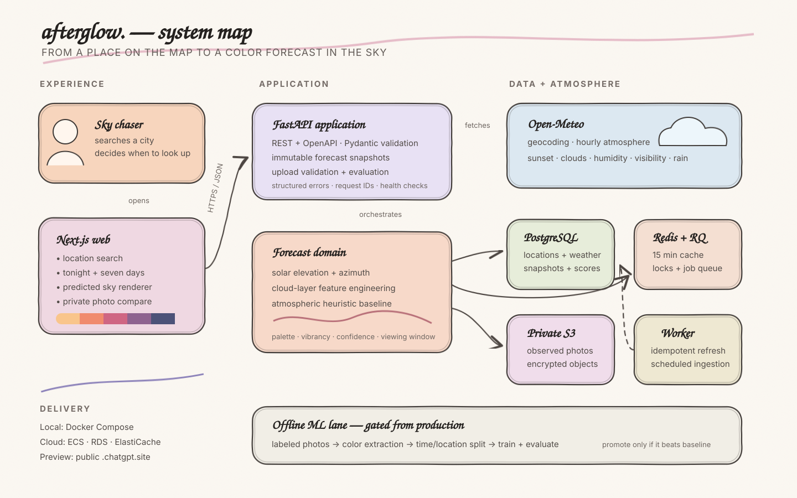

<div align="center">


# afterglow.

### Chase the beautiful.

**Sunset intelligence for people who appreciate beautiful skies.**<br />
Afterglow turns live atmospheric forecasts and solar geometry into a calm, colorful answer to one question: *is tonight worth stepping outside for?*

[](https://afterglow-sky-forecast.perkyaisle4.chatgpt.site/)
[](./apps/web)
[](./services/api)
[](#quality)

[**Open Afterglow ↗**](https://afterglow-sky-forecast.perkyaisle4.chatgpt.site/) · [Architecture](#architecture) · [Quick start](#quick-start) · [API](#api-surface)

<br />

| `Peach` | `Coral` | `Rose` | `Lavender` | `Twilight` |
|:---:|:---:|:---:|:---:|:---:|
| 🟧 | 🟠 | 🩷 | 🟪 | 🌌 |

</div>

---

## The sky, before it happens

Traditional weather apps tell you whether it will rain. Afterglow is designed around the emotional decision hiding underneath the forecast:

> **Open Afterglow → see tonight’s sky → decide whether to go outside.**

For any supported location, Afterglow presents:

- a five-color predicted sunset palette;
- a 0–100 vibrancy score and confidence estimate;
- the best local-time viewing window;
- cloud-layer, humidity, precipitation, and visibility context;
- a seven-evening outlook with the strongest sunset highlighted; and
- private in-browser photo verification using perceptual color comparison; and
- an optional OpenAI vision reading with a color story, atmospheric interpretation, forecast match, and photography tip.

The sunset visualization is explicitly an **interpretation of forecast conditions**, not a fabricated photograph of the future.

## Experience

| Tonight | The week ahead | Close the loop + AI |
| --- | --- | --- |
| Live local sunset time, palette, vibrancy, confidence, and a natural-language reading. | Seven comparable evenings with uncertainty that grows with forecast horizon. | Compare colors privately, then optionally ask AI to interpret the photographed sky against the forecast. |

The interface is mobile-first, keyboard accessible, reduced-motion aware, and intentionally unlike a conventional weather dashboard.

## Architecture

<div align="center">
  <a href="./docs/architecture.svg">
    
  </a>
  <br />
  <sub>Click the diagram for a full-size view.</sub>
</div>

Afterglow is a **modular monolith**: one product, clean internal boundaries, no ceremonial microservices.

| Layer | Responsibilities |
| --- | --- |
| **Next.js web** | Editorial UI, location search, query lifecycle, deterministic sky visualization, responsive interactions |
| **Hosted site worker** | Static asset delivery, protected OpenAI Responses API proxy, validation, rate limiting |
| **FastAPI application** | Validation, forecast orchestration, immutable snapshots, uploads, evaluations, OpenAPI |
| **Forecast domain** | Solar position, sunset windows, atmospheric feature engineering, palettes, vibrancy, confidence |
| **Data layer** | PostgreSQL records, Redis cache and RQ jobs, local/S3-compatible private image storage |
| **Offline ML** | Leakage-safe feature building, time/location splits, model training, artifact and metric output |
| **Infrastructure** | Docker Compose locally; ECS, RDS, ElastiCache, S3, ECR, and CloudWatch-ready Terraform for AWS |

Read the deeper [architecture notes](./docs/architecture.md) and [deployment guide](./docs/deployment.md).

## How the forecast works

```text
location
   ↓
Open-Meteo hourly weather + local sunset time
   ↓
cloud layers · humidity · visibility · precipitation · forecast horizon
   ↓
solar geometry + atmospheric heuristic baseline
   ↓
palette · vibrancy · confidence · best viewing window
   ↓
immutable prediction snapshot → optional observed-photo evaluation
```

The production model is deliberately labeled **heuristic**. Weather APIs do not directly forecast sunset colors, and this project does not claim trained-model performance without a representative labeled dataset and a real held-out evaluation.

## Technology

| Product | Data and intelligence | Delivery |
| --- | --- | --- |
| Next.js 15, React 19, TypeScript | Python 3.12, FastAPI, Pydantic | Docker and Docker Compose |
| TanStack Query, Motion, Tailwind CSS | SQLAlchemy, Alembic, PostgreSQL | AWS ECS Fargate starter |
| Accessible responsive components | Redis, RQ, Pillow, scikit-learn | Terraform and GitHub Actions |
| Deterministic CSS sky renderer | Open-Meteo weather and geocoding | Public `.chatgpt.site` worker deployment |
| Bilingual English/Chinese experience | OpenAI vision sky interpretation | Server-side secrets and request throttling |

## Repository map

```text
afterglow/
├── apps/web/                  # Next.js App Router experience
├── services/site-worker/      # Public Site runtime + protected AI endpoint
├── scripts/                   # Site build, preview, and AI smoke checks
├── services/api/              # FastAPI modular monolith + migrations
├── services/worker/           # Redis/RQ background jobs
├── ml/
│   ├── features/              # Reproducible feature construction
│   ├── training/              # Leakage-aware training entrypoint
│   └── evaluation/            # Model promotion contract
├── infrastructure/terraform/  # AWS production starter
├── tests/load/                # k6 scenario
├── docs/                      # Architecture and deployment notes
├── docker-compose.yml
└── .env.example
```

## Quick start

### Docker Compose

The complete local stack includes the web app, API, PostgreSQL, Redis, and the RQ worker.

```bash
cp .env.example .env
docker compose up --build
```

| Service | URL |
| --- | --- |
| Afterglow | [http://localhost:3000](http://localhost:3000) |
| API | [http://localhost:8000](http://localhost:8000) |
| OpenAPI | [http://localhost:8000/docs](http://localhost:8000/docs) |

### Native development

Use Python 3.12+, Node.js 22+, and pnpm.

```bash
python -m venv .venv
# Windows: .venv\Scripts\activate
# macOS/Linux: source .venv/bin/activate

pip install -r services/api/requirements.txt
alembic -c services/api/alembic.ini upgrade head
uvicorn services.api.app.main:app --reload --port 8000
```

In another terminal:

```bash
pnpm install
pnpm --dir apps/web dev
```

## Configuration

Copy [`.env.example`](./.env.example) and adjust only what your environment needs.

| Variable | Purpose | Local default |
| --- | --- | --- |
| `NEXT_PUBLIC_API_URL` | Browser-facing FastAPI origin | `http://localhost:8000` |
| `DATABASE_URL` | SQLAlchemy connection | SQLite natively; PostgreSQL in Compose |
| `REDIS_URL` | Cache, locks, and RQ | `redis://localhost:6379/0` |
| `UPLOAD_DIRECTORY` | Development photo storage | `data/uploads` |
| `MAX_UPLOAD_BYTES` | Upload ceiling | `10485760` |
| `S3_BUCKET` | Enables private S3-compatible storage | unset |
| `S3_ENDPOINT_URL` | Optional compatible endpoint | unset |
| `OPEN_METEO_TIMEOUT_SECONDS` | Upstream request timeout | `10` |
| `ALLOWED_ORIGINS` | CORS allowlist | `http://localhost:3000` |
| `OPENAI_API_KEY` | Optional server-side AI sky readings | unset |
| `OPENAI_MODEL` | Vision-capable Responses API model | `gpt-4.1-mini` |

Open-Meteo requires no API key. The OpenAI key is used only by the server-side Site worker and must never use a `NEXT_PUBLIC_` prefix or be committed. The deployed site stores it as a protected runtime secret.

## API surface

```http
GET  /api/v1/locations/search?q=...
GET  /api/v1/forecast
GET  /api/v1/forecast/weekly
GET  /api/v1/forecast/{prediction_id}
POST /api/v1/observations
GET  /api/v1/evaluations/{prediction_id}
POST /api/ai/analyze
GET  /health
GET  /ready
```

The interactive schema is available at `/docs` whenever the API is running.

## Quality

```bash
# Backend unit and API integration tests
pytest

# Frontend component tests and production build
pnpm --dir apps/web test
pnpm --dir apps/web build
pnpm test:worker

# Browser and load checks
pnpm --dir apps/web test:e2e
k6 run tests/load/forecast.js
```

The checked-in suite covers solar calculations, prediction behavior, confidence decay, JSON-safe feature snapshots, palette extraction, API validation, and multipart observation evaluation. CI repeats the Python tests, Alembic migration, frontend tests, and production build.

## ML contract

The trained-model pipeline is present but intentionally **not promoted to production** without real labels.

```bash
python -m ml.training.train \
  --input data/labeled_sunsets.csv \
  --output ml/artifacts
```

Any candidate must beat the deterministic baseline using splits separated by both **time and location**. Evaluation should report palette Delta E, dominant-color accuracy, vibrancy MAE, confidence calibration, and performance across location, season, camera source, and forecast horizon.

See the complete [evaluation contract](./ml/evaluation/README.md).

## Important limitations

- Ordinary weather forecasts do not fully observe aerosols, smoke layers, terrain obstruction, or localized marine layers.
- Camera exposure, white balance, HDR, editing, crop, and foreground pixels affect observed-color evaluation.
- The current CIE76 nearest-palette comparison is product feedback, not a scientific accuracy claim.
- The public deployment performs the forecast directly against Open-Meteo and uses a small server worker for optional AI analysis; the full local/AWS architecture adds durable snapshots, queues, caching, and object storage.
- AI sky readings are visual interpretations, not measurements of aerosols, pollution, or safety-critical weather conditions.

## Roadmap

- [ ] Build a consented, timestamped, geolocated sunset image dataset
- [ ] Add smoke, aerosol, and terrain-horizon signals where licensing permits
- [ ] Add authenticated personal observation history and deletion controls
- [ ] Calibrate confidence against measured out-of-sample error
- [ ] Promote a trained model only after baseline-beating evaluation

## Deployment

- **Public preview:** [afterglow-sky-forecast.perkyaisle4.chatgpt.site](https://afterglow-sky-forecast.perkyaisle4.chatgpt.site/)
- **Local:** Docker Compose or native processes
- **AWS-ready:** ECS Fargate, RDS PostgreSQL, ElastiCache Redis, private S3, ECR, CloudWatch, and Terraform

Paid infrastructure is never provisioned automatically. Review [the deployment guide](./docs/deployment.md) and current provider pricing before applying Terraform.

---

<div align="center">

Built for the few minutes each day that never happen the same way twice.

**afterglow.** · *Chase the beautiful.*

</div>
